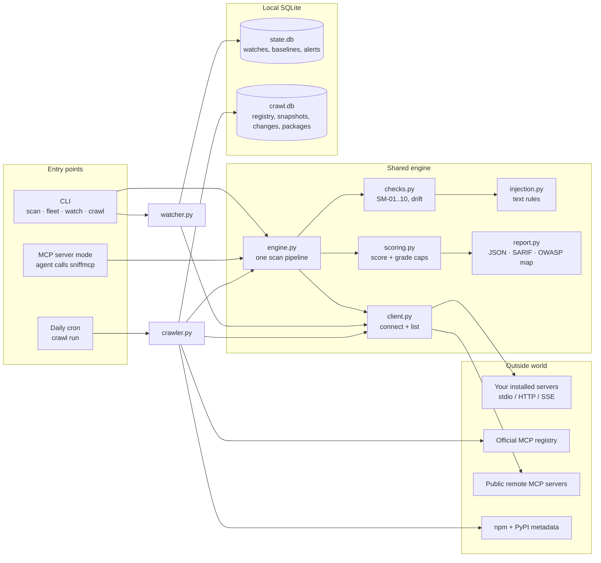
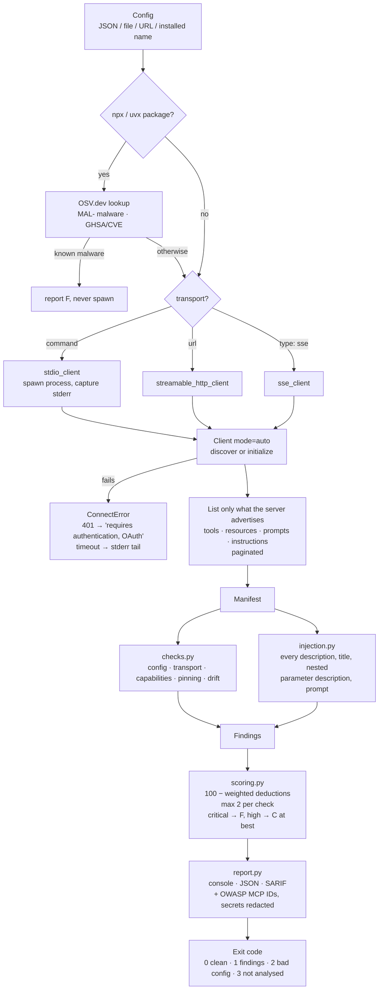
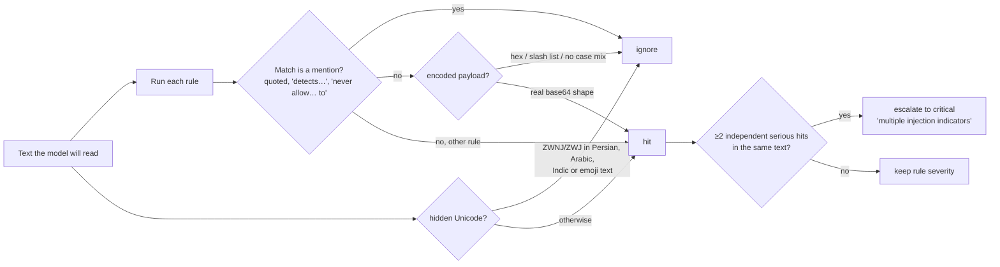
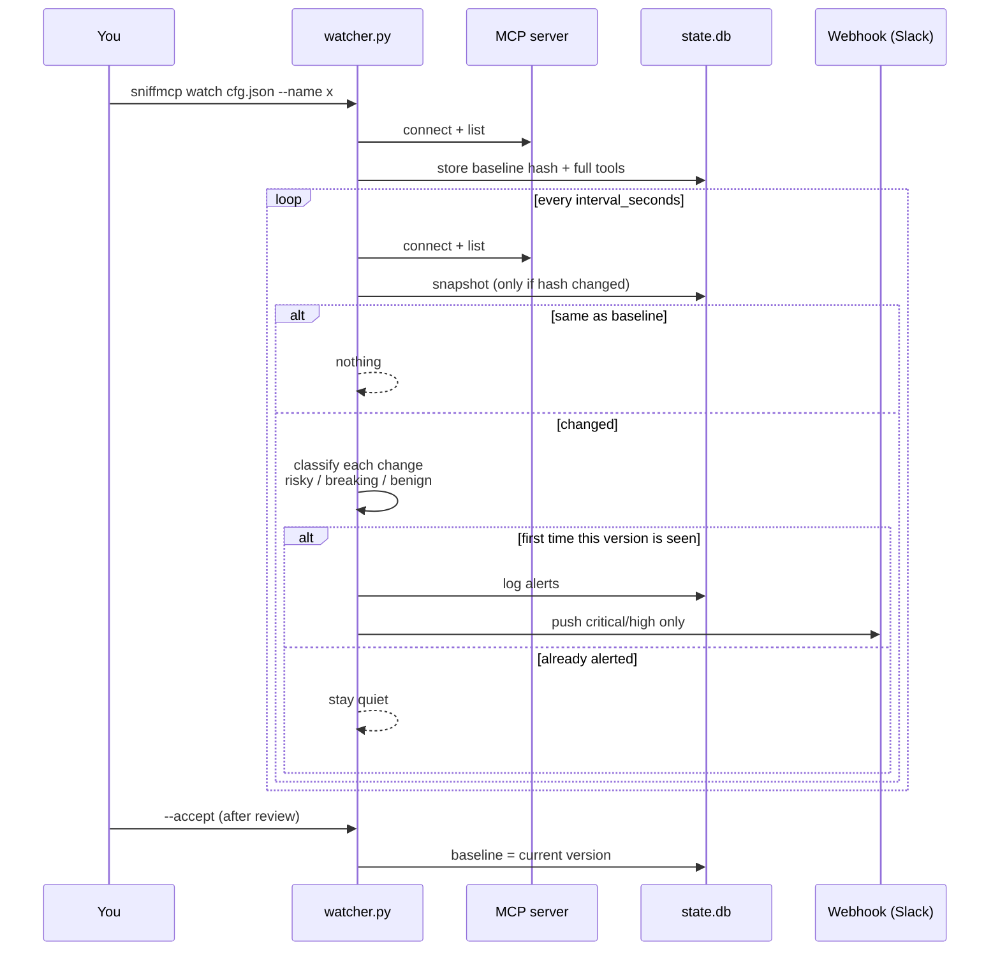
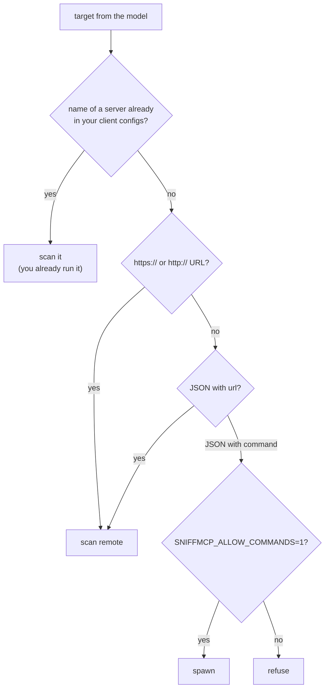
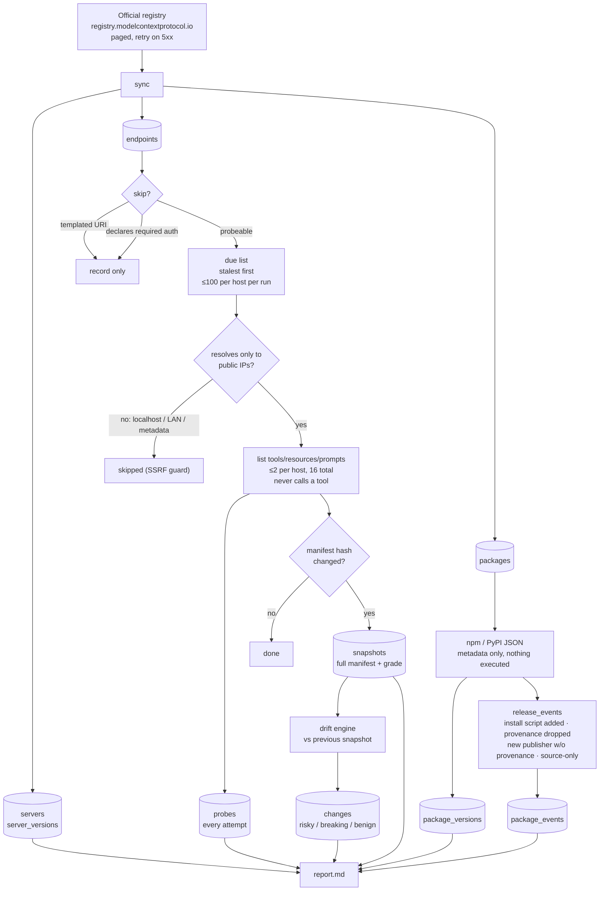
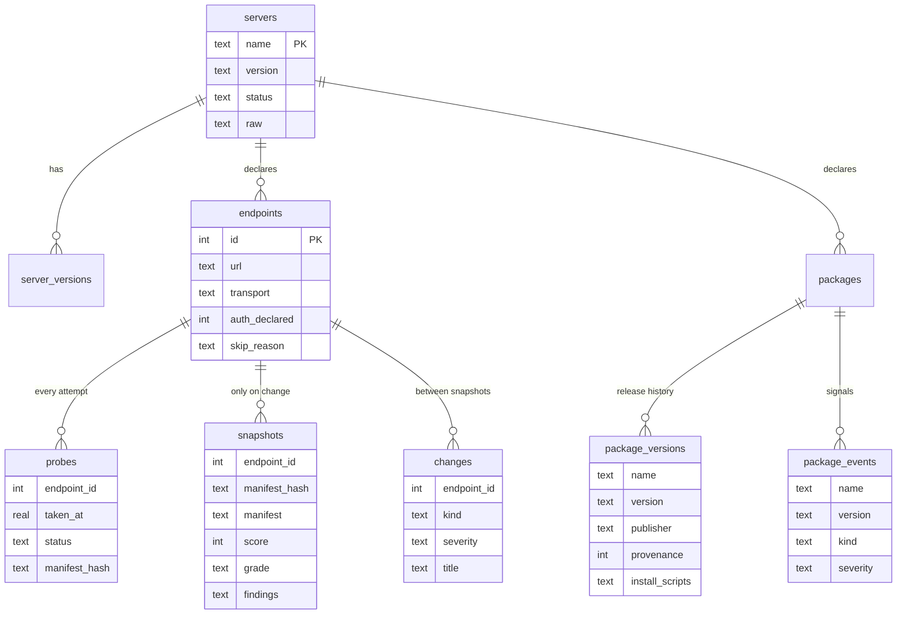

# sniffmcp architecture

*As of 2026-10-09. See [README.md](README.md) for what it does and how to use it.*

## 1. The big picture

sniffmcp has three entry points and one shared engine. Everything that grades a server goes through the same pipeline, so the CLI, the watcher, the MCP server mode and the crawler always agree.

## 2. What we're built on

| Layer | What we use | Why |
|---|---|---|
| Language | Python 3.11+ (venv runs 3.12) | The official MCP SDK is first-class in Python |
| MCP protocol | **Official `mcp` SDK 2.3** (`Client`, `stdio_client`, `streamable_http_client`, `sse_client`, `MCPServer`) | We never hand-roll the protocol. `Client(mode="auto")` speaks both the legacy `initialize` handshake and the 2026-07-28 `server/discover` |
| HTTP | `httpx2` (ships with the SDK) | Auth-error probing, registry and npm/PyPI calls |
| Async | `asyncio` / `anyio` | Parallel fleet scans and crawl probes with semaphores |
| Storage | `sqlite3` (stdlib), WAL mode | Zero-ops, single file, good enough for millions of rows |
| Detection | Pure-Python regex rules + capability tokenizer | Free, instant, deterministic, testable. No LLM required |
| Output | JSON, **SARIF 2.1.0**, Markdown | CI gates, GitHub code scanning, human reports |
| Tests | `pytest` + `pytest-asyncio`, a real stdio fixture server | Covers the full path, not just pure functions |
| Runtime deps | **Exactly one: `mcp`** | Small attack surface for a security tool |

## 3. Scanning one server

### How a text rule decides

Precision over recall. Every rule must stay silent on ~30 real descriptions from the crawl that once fooled it.

## 4. Watching for changes (rug pulls)

**Classification:**

| Change | Class | Severity |
|---|---|---|
| New or changed text gains an injection indicator | risky | critical |
| New exec / destructive / secret-reading tool | risky | high |
| Description gains a URL | risky | medium |
| Tool turns from read-only to destructive (annotations) | risky | medium |
| Tool removed, new required parameter | breaking | low |
| Wording change, harmless new tool | benign | info |

## 5. MCP server mode: guarding against our own tool

A scanner that a model can tell to "scan `{"command": "rm -rf ~"}`" is a remote-code-execution hole. Target resolution is the guard:

The HTTP server mode binds to `127.0.0.1` only.

## 6. The ecosystem crawler

### Crawl database

## 7. Public standards and data: what we use, and what we don't yet

Which public standards, threat research and data feeds sniffmcp builds on, and which it doesn't yet.

| Source | Used? | How |
|---|---|---|
| **OWASP MCP Top 10** (beta, 2025) | ✅ as of today | Every finding is tagged with OWASP IDs in JSON and SARIF. **Caveat:** our own IDs (`SM-01`…) don't follow OWASP numbering; see the map below |
| **Invariant Labs tool-poisoning research** (the `<IMPORTANT>` / read `~/.cursor/mcp.json` proof of concept) | ✅ | It's a regression test; our rules must grade it F |
| **Deadbugz write-ups** (Pillar Security, CSA, 2026) | ✅ | Shaped the drift checks and the fixture's rug-pull mode. It's also why we document that polling can't catch session-gated payloads |
| **Official MCP registry** | ✅ | Source of the crawl |
| **npm provenance / trusted publishing, PyPI metadata** | ✅ | Package release signals |
| **MCP spec tool annotations** (`readOnlyHint`, `destructiveHint`) | ✅ | Annotation-vs-name contradictions and annotation drift |
| **OSV.dev malicious-package advisories** (`MAL-…`, OpenSSF malicious-packages feed) | ✅ | `SM-11`. The scanner checks the package **before spawning it** and refuses to launch known malware. The crawler checks every registry package (`crawl advisories`) |
| **CVE / GHSA / PYSEC advisories** | ✅ | `SM-12`, via the same OSV queries. Pinned versions are checked exactly; unpinned ones at today's latest (what `npx`/`uvx` would run) |
| **Cisco mcp-scanner YARA rules** (Apache-2.0) | ✅ as a **benchmark**, not a dependency | `scripts/benchmark_yara.py` fetches them at a pinned commit and runs them head-to-head with ours on the labelled corpus and all 10k crawled servers. Results: `reports/benchmark-cisco-yara-*.md`. One lead they surfaced that we missed became a new rule ("installs code into agent config") |
| **LLM-as-judge** | ❌ (hook exists: `analyze_descriptions(llm_hook=…)`) | Cisco and Snyk use one. Optional second opinion for ambiguous text |

### Our checks mapped to OWASP MCP Top 10

| OWASP | Category | Our checks | Coverage |
|---|---|---|---|
| MCP01 | Token Mismanagement & Secret Exposure | SM-02, SM-05 | 🟢 config secrets, redaction |
| MCP02 | Privilege Escalation via Scope Creep | SM-04 | 🟡 capabilities only; we can't see token scopes |
| MCP03 | Tool Poisoning | INJ-HEUR, SM-01, SM-03, SM-08, SM-09, FLEET-01 | 🟢 our strongest area |
| MCP04 | Supply Chain & Dependency Tampering | SM-07, SM-10, **SM-11 (malware), SM-12 (CVEs)**, crawler package signals | 🟢 pinning, provenance, OSV malware + vulnerabilities |
| MCP05 | Command Injection & Execution | SM-04 (flags exec tools) | 🔴 we can't see handler code |
| MCP06 | Intent Flow Subversion | INJ-HEUR, SM-01 | 🟡 text only |
| MCP07 | Insufficient AuthN/AuthZ | SM-06, crawler auth stats | 🟡 transport + auth presence |
| MCP08 | Lack of Audit & Telemetry | — | 🔴 out of scope for a scanner |
| MCP09 | Shadow MCP Servers | `fleet` discovery (inventory) | 🟡 lists what's installed; no org-wide view |
| MCP10 | Context Injection & Over-Sharing | SM-05 | 🟡 |

## 8. How our approach compares

| | **sniffmcp** | **Snyk Agent Scan** (ex-Invariant mcp-scan) | **Cisco mcp-scanner** (open source) | **MCP-Sentinel** | **MCP-Shield** (indie) |
|---|---|---|---|---|---|
| Scans | Installed servers, live | Installed servers, live | Servers / tools, live | Server **source code** | Installed servers |
| Detection | Regex rules tuned on 10k real servers | Hosted analysis + rules | YARA + LLM judge + Cisco AI Defense | AST, Semgrep, LLM, Docker probes | Rules |
| Account / upload | **None, fully local** | Snyk token; tool data sent to Snyk | Local YARA; LLM/API optional | OpenAI key for full value | Local |
| Drift / rug pull | **Classified** risky / breaking / benign, alert once | Hash pinning (alerts on any change) | Rug-pull detection claimed | CI baselines (findings) | — |
| Ecosystem dataset | **Daily crawl of the whole registry, with history** | Not public | No | No | No |
| Package supply chain | OSV malware + CVEs (pre-spawn block), provenance drop, install scripts, publisher change | Snyk platform | — | Provenance | Typosquats, CVEs |
| Sees handler behaviour | ❌ | ❌ | Partly (LLM over implementations) | ✅ (source + probes) | ❌ |
| OAuth servers | ❌ yet | ✅ (via client) | depends | n/a | ? |
| Maturity | Days old | Most mature, Snyk-backed | ~900 stars | v1.4 | small |

**Where we're genuinely better:**
- **Calibrated precision.** Our rules were tested against 10,409 real servers, with every high/critical hit checked by hand. We have the false-positive corpus to prove it. Nobody else publishes that.
- **Fully local, one dependency.**
- **Drift that doesn't cry wolf.**
- **The longitudinal registry dataset.**

**Where we're worse:**
- No LLM or semantic analysis.
- No source or behaviour analysis.
- No OAuth.
- No track record. *None* of these tools, including ours, publish independently audited detection rates.

**What would actually make us defensible:** the dataset plus the published false-positive and true-positive corpus. A public benchmark that every scanner can be measured against is something the others can't easily copy.

## 9. Design decisions worth knowing

1. **One pipeline (`engine.py`).** The three duplicated copies from the original code drifted apart; now there's one.
2. **List calls only, never `tools/call`.** Keeps scanning safe for the scanned server and for us.
3. **Snapshots on change, probes always.** Small database, honest availability stats.
4. **Grade caps.** A confirmed injection can never "pass" through weighted maths.
5. **Capabilities aren't defects.** Write or exec tools are reported, not punished, so legitimate servers stay A/B.
6. **Mentions aren't attacks.** Security tools quote attack phrases; we skip quoted, negated or "detects…" contexts.
7. **SSRF guard in the crawler.** Registry entries are untrusted input.
8. **Secrets never echoed.** Reports end up in CI logs and SARIF uploads.

## 10. Next technical steps

1. ~~OSV integration~~ ✅ done (`SM-11`, `SM-12`, pre-spawn malware block, `crawl advisories`).
2. ~~Rename our IDs~~ ✅ done (`MCP-xx` → `SM-xx`, report schema 2.0.0).
3. **Publish the corpus**: the real-world false positives plus known attacks as a benchmark set.
4. **OAuth** in `client.py` (the SDK has an OAuth client provider), so the 36% of auth-gated servers become scannable.
5. **Optional LLM judge** behind the existing hook, only for ambiguous hits.
6. **Session proxy** (later): the only way to catch Deadbugz-style payloads that change mid-session.

---
Sources: [OWASP MCP Top 10](https://owasp.org/www-project-mcp-top-10/) · [Nordic APIs guide](https://nordicapis.com/guide-to-the-owasp-mcp-top-10/) · [Cisco mcp-scanner](https://blogs.cisco.com/ai/securing-the-ai-agent-supply-chain-with-ciscos-open-source-mcp-scanner) · [Scanner comparison (AgenticWire)](https://www.agenticwire.news/article/mcp-security-scanners-comparison) · [Snyk Agent Scan (appsecsanta)](https://appsecsanta.com/mcp-scan) · [OSV malicious packages (OpenSSF)](https://openssf.org/?p=11003) · [Deadbugz (Pillar Security)](https://www.pillar.security/blog/deadbugz-currently-active-mcp-supply-chain-campaign)
